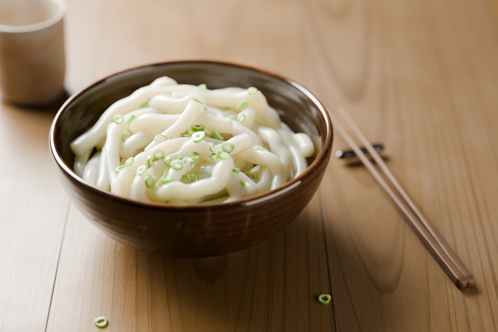

# Noodle Box for Blender

An installable Blender add-on for cooked noodle piles with real weight: true gravity, inextensible strands, bending from a Young's modulus, Coulomb friction, starch cohesion, floor contact, and closed-mesh colliders. Includes six noodle types, a sidebar, and a one-click bowl demo. No external packages or network access required at runtime.

Requires **Blender 5.2+**. Tested locally with Blender 5.2.0 LTS.

## Install and start

1. Download [noodle_box-1.0.0.zip](dist/noodle_box-1.0.0.zip). Leave it zipped.
2. In Blender, open **Edit > Preferences > Get Extensions**, open the menu at the top right, and choose **Install from Disk**. Select the ZIP and enable **Noodle Box**. This is Blender's [local extension installation](https://docs.blender.org/manual/en/5.0/advanced/extensions/getting_started.html) workflow.
3. In a 3D Viewport, press **N** and open the **Noodles** tab. Choose a type and click **Add Noodles**, or click **Create Bowl Demo**.
4. Click **Frame Noodles**, then **Play**. After editing simulation settings, click **Restart** and replay from the start.

Installing/enabling the add-on does not create objects. Disabling it removes its controls and properties; existing Geometry Nodes objects remain usable. Re-enable it to restore the sidebar. Blender 5.2 or newer is required.

For development, `noodle_physics.py` remains a compatibility launcher. Keep it next to the `noodle_box/` folder; it is no longer a standalone single-file solver.

## Noodle types

Choose a type in the sidebar's **Noodle library**. **Apply Type** updates dimensions, flexibility, cohesion, material, and profile shape, then restarts the selected pile. Collider assignments and seed are preserved. Turn off **Use suggested strand count** to preserve your count too.

| Type | Length | Width | Cross-section and look | Suggested count |
| --- | ---: | ---: | --- | ---: |
| Udon | 24 cm | 10 mm | Knife-cut rounded square, uneven thickness; warm ivory, glassy-wet film over a faintly matte skin, strongly translucent with a warm glow | 32 |
| Ramen | 22 cm | 5 mm | Nearly round, gently crinkled; kansui yellow, satin skin under crisp highlights | 24 |
| Spaghetti | 24 cm | 2.4 mm | Round; golden, semi-translucent, bronze-die micro-roughness | 12 |
| Soba | 20 cm | 3.6 mm | Knife-cut square; taupe grey-brown with a faint olive cast, glossy from rinsing, fine sparse husk specks | 18 |
| Rice Ribbon | 18 cm | 10 mm | Flat (20% thickness), uneven, with wandering edges and faint creases; milky, cloudy-translucent, oily gloss | 20 |
| Fettuccine | 24 cm | 7 mm | Flat (28% thickness) with softened edges; egg-yellow, slightly rough | 20 |

Physical behaviour:

| Type | Young's modulus | Drape length L_g | Friction |
| --- | ---: | ---: | ---: |
| Udon | 100 kPa | 39 mm | 0.30 |
| Ramen | 250 kPa | 34 mm | 0.30 |
| Spaghetti | 2 MPa | 41 mm | 0.25 |
| Soba | 300 kPa | 29 mm | 0.35 |
| Rice Ribbon | 150 kPa | 18 mm* | 0.25 |
| Fettuccine | 1 MPa | 31 mm* | 0.30 |

The drape length is the elasto-gravity length L_g = (E I / (rho g A))^(1/3), with density 1050 kg/m^3: roughly the radius a strand curves over when it hangs across an edge. *Ribbons bend across their thin side, so their modulus is scaled by 4/3 x aspect^2 for the round-section solver; for Rice Ribbon that falls below the 10 kPa floor of the Stiffness range and is clamped there.

These are editable, art-directed examples. Thin spaghetti and soba can require more than the 24-step runtime ceiling; the sidebar reports that limit, and their fall may be speed-clamped. Udon is the preferred live-preview starting point.

Ribbon profiles change the visible cross-section. Collision still uses a round envelope at the full width, so ribbon stacks can look more separated than their visible thickness implies. **Smooth Surface** rounds the displayed curve between simulation points without increasing the physics point count. It adds mesh cost and can slightly overshoot the sampled collision shape. Disable it to inspect the exact simulated polyline.

### Material and surface

Each type has its own **Noodle Box - <Type>** material (built in `noodle_box/materials.py`, values in `LOOKS` in `noodle_box/presets.py`). It is a Principled BSDF made to read as cooked starch rather than plastic:

- **Random-walk subsurface** with a per-type mean free path: thin parts, edges and backlit strands glow, and shadows between strands stay warm.
- A **starch-water film** on the Coat layer (IOR 1.33, low roughness). Its strength wanders in centimetre patches and per strand, so some areas are wet and sharp while others have dried to satin. The film follows only the broad undulation of the noodle, not the fine relief beneath it.
- **Colour variation** at low frequency within each strand and between strands (from `np_id`), plus paler flour/starch blotches and tiny trapped bubbles.
- **Micro relief** by bump: striations along the strand, shallow dimples, broad low undulation, fine skin texture and grit (strong on bronze-die spaghetti). The water film carries its own tiny ripples, which give wet noodles their sharp specular sparkle. Soba adds fine husk specks; rice ribbons add occasional creases. Cut faces are drier, rougher and paler than the sides.

All texture coordinates come from attributes the solver writes on the display mesh, so detail is fixed to the noodle and does not swim as strands move: `nb_prof` (position in the cross-section, metres), `nb_along` (arc length from the strand start, metres), `nb_end` (distance to the nearer cut end, metres) and `np_id`. Cycles is the reference. EEVEE renders the same network, with EEVEE's own subsurface instead of random walk, so translucency is softer there. Materials saved by an older version are rebuilt automatically.

The display surface also takes these **Noodles** inputs, which are display only. They are applied after the simulation zone, so they never move simulated points or change contacts:

| Input | Effect |
| --- | --- |
| Profile Squareness | Round (0) towards a rounded square (1), as in knife-cut udon and soba. With Profile Aspect below 1 it gives flat ribbons with softened edges |
| Waviness | Crinkle along the strand, as in wavy ramen. Use with Smooth Surface; on the raw polyline it is coarsely sampled |
| Thickness Variation | Slow, uneven thickness along each strand |
| End Softness | Rounded fillet on each cut end instead of a sharp flat cap, as a fraction of the radius; the two ends of a strand differ slightly |
| Render Faces | Tube sides used in final renders (default 24). The viewport keeps the cheaper Profile Faces, and Smooth Surface uses 6 instead of 3 samples per segment in renders |
| Edge Irregularity | Wandering cut edges and uneven thickness across the width, so ribbons are not perfect extrusions. Rice Ribbon uses 1, Fettuccine 0.35 |

The rounded-square corners extend slightly past the round collision envelope, and crinkles and thickness variation are not seen by collisions, so close contacts can show small overlaps.

The existing Fast / Balanced / Quality shortcuts remain available separately. They change thickness and solver budget; they are not noodle type selections.

## Bowl demo

Click **Create Bowl Demo** to create a **separate scene**, leaving your current scene intact. It is set up like a food photograph rather than a studio test, and is still created instantly (nothing is baked until you play):

- **Bowl**: a thrown stoneware donburi, 19.9 cm across and 8.3 cm tall, with 6-9 mm walls, a rounded lip and a trimmed foot ring. A slight oval, rim undulation and radial ripple give it a hand-made wobble. It is one closed, watertight mesh and is the noodle **Collider**; walls are kept thicker than about 1.2 noodle radii so the voxelised distance field cannot leak.
- **Glaze**: a procedural iron (kaki/tenmoku) glaze that pools dark in the well, breaks to rust over the lip and throwing ridges, with hare's-fur streaks, iron spots, pinholes and an orange-peel surface. The foot is raw, kiln-toasted clay below a wavy glaze line.
- **Table**: procedural oiled oak boards with flat-sawn growth rings, open pores, fibre, ray flecks, fine scratches in the oil finish, seams and wear. The 85 mm lens never sees an edge or horizon.
- **Light**: a 1.1 x 0.8 m window key behind-left and above (120 W area light), a bounce card front-right, a black negative-fill flag and a weak overhead room fill. The glaze reflects a separate glossy-only window pane: a sheer curtain that glows in the middle and falls off toward the frame, with soft mullion shadows, and the world is a dim room gradient.
- **Camera**: 85 mm on full frame, about 34 degrees above the table, f/2.8 focused on the *Focus - front of noodles* empty, 3:2 frame. Cycles with adaptive sampling and OpenImageDenoise guided by albedo and normal passes (Accurate prefilter), AgX Medium High Contrast, plus a compositor lens finish (soft vignette, fine grain).
- **Props**: oiled walnut chopsticks (22.8 cm, rounded-square 7.5 mm tops tapering to 2 mm points) on a glazed hashioki to the right of the bowl, and an out-of-focus teacup behind.

The pile uses 36 Udon strands (a full serving, about 0.7 L of noodle; roughly 0.2 s per frame headless on a shared 4-core machine), Fill Diameter 0.09 m, Start Height 0.12 m and **Spawn Coil 0.3**. Fully coiled spawns reach about 17 cm from the axis and drape over the rim; at 0.3 every strand lands in the bowl with the default seed. Other seeds with 32 or more strands can still push a strand over the rim. Re-applying a noodle type restores Spawn Coil 1. Play forward from frame 1. Use the scene selector to return to your previous scene. Set assets live in `noodle_box/scene_assets.py`.

Alternatively open [noodle_box_demo.blend](demo/noodle_box_demo.blend). It includes the playable setup and a **Finished Preview** scene containing a static frame-100 snapshot garnished with 1.5-3 mm scallion slices dropped onto the baked pile, so the finished example is visible without rebuilding a cache. The static preview is a mesh reference, not another live solver. `tools/build_demo.py` renders it at 1600 x 1067, 512 samples, adaptive threshold 0.008; set `NOODLE_DEMO_SAMPLES`, `NOODLE_DEMO_THRESHOLD`, `NOODLE_DEMO_SIZE` (for example `750x500`) or `NOODLE_DEMO_THREADS` for a quicker check. A short guide is included in the file's Text Editor.



The sidebar provides Fast / Balanced / Quality presets, play/pause, cache reset, framing, a point-count estimate, scale warnings, and **Fit Step Budget**. Inputs are grouped into Noodles, Spawn, Solver, Colliders, and Sticky colliders in both the sidebar and the modifier.

For older generated piles, the sidebar shows **Update Solver**. Updating preserves input values and object transforms and restarts the simulation. Other piles sharing the old group remain untouched. **Add Another Pile** creates an independent solver. The development launcher also upgrades an existing pile when rerun.

## World scale

**One Blender unit is one metre.** New objects have identity transforms. The base solver uses the dimensions below; the noodle type library applies its own dimensions from the earlier table.

| Setting | Value |
| --- | ---: |
| Strand length | 0.25 m |
| Strand radius | 0.006 m (12 mm diameter) |
| Spawn disc diameter | 0.20 m |
| Spawn height | 0.12 m |
| Gravity | 9.81 m/s² |

Setup selects metric units with Unit Scale 1. This changes the scene's unit display, not the geometry of other objects. Gravity and the floor operate in the noodle object's local space: moving or rotating the object also moves or rotates its simulation frame. Leave object scale at 1 and change the length/radius inputs to change physical size.

These are thick preview noodles. Thin spaghetti needs many more points and substeps. Existing scenes made with the old 1000-unit defaults are preserved, **not automatically migrated**. Create a new pile at metre scale; scaling the old object down alone does not correct its physical timing.

## Real-time preview

Two changes reduce solver cost:

- **Adaptive Substeps** estimates the required steps from the fastest stored point velocity plus a full frame of gravity. A contact-stability minimum also limits gravity-induced movement per step to 10% of the radius. This prevents slow piles from dropping to too few steps and shaking. **Substeps** remains the maximum budget; too small a budget can still cause jitter. Disable adaptation for fixed-step comparisons.
- Empty collider branches bypass their distance-field sampling and position updates. Assigned object and collection colliders still use the full contact solver.

Air drag is physical (see Physics model) and every damping term is integrated over elapsed seconds, so changing timeline FPS does not change the motion over the same duration. **Damping** adds optional extra drag on top and defaults to 0. Simulation playback uses **Play Every Frame**; skipping frames cannot substitute for solving them.

**Contact Damping** lets a heap come to rest. A position-based contact solve never balances forces exactly, so a heap in which every strand is held still trades a few mm/s back and forth. That residual has no direction, real motion does: each point keeps a running mean of its displacement over 0.3 s, and a point resting on other noodles whose mean drift is slower than 0.2 x sqrt(gravity x radius) (44 mm/s for udon) is held still. A point sliding on a floor or collider faster than its friction allows is never held, so Coulomb sliding starts and runs normally; free fall and moving colliders are untouched. 0 disables it.

## Physics model

Solver revision 5 was rebuilt for weight. Each substep integrates gravity and drag, then runs **Iterations** contact passes (nearest-neighbour queries, noodle contact, floor and collider contact, an exact stretch solve), then an exact bending solve, velocity readback, friction, cohesion, rest detection, a final non-penetration pass and plastic creep.

- **Inextensible strands.** All of a strand's length constraints are solved together as one tridiagonal system (parallel cyclic reduction), so tension carries the whole weight of a hanging tail. The previous local Jacobi passes let a draped strand hang 14% longer than its length; now it hangs within 5% (the bending solve after the passes is not followed by another length solve).
- **Bending from a Young's modulus.** The constraint at each point is its offset from the midpoint of its neighbours, with compliance rho l^4 / (E r^2): a beam of modulus E, scaled correctly with radius and point spacing. It is solved exactly per strand once per substep (a complex tridiagonal factorisation of the fourth-difference matrix, cached between frames). **Stiffness** maps logarithmically onto E: 0 = 10 kPa, 0.33 = 100 kPa (udon), 0.77 = 2 MPa (al dente spaghetti), 1 = 10 MPa. Bending is damped viscoelastically (relaxation time 0.03 s), so bent noodles ease into shape rather than ringing.
- **Plasticity.** Cooked dough is viscoplastic: a bend that is held sets. Each joint's rest bend creeps towards 60% of its current bend with a 0.4 s time constant, so strands lying curled in the heap keep soft curls instead of springing back into straight sticks, while the remaining 40% elasticity keeps held bends from creeping into kinks.
- **Air drag** is quadratic and acts only across the strand: a = 0.5 rho_air Cd 2r v^2 / (rho pi r^2). A dropped udon strand falls at 9.75-9.81 m/s^2; the old 0.03-per-frame linear damping made it 8.17.
- **Coulomb friction.** The tangential speed a contact may remove is Friction (or Collider Friction) times its normal push, summed over the passes, so friction grows with the load on it. A strand on a ceramic-like slope with friction 0.5 holds below atan(0.5) = 26.6 degrees and slides above it. Floor and collider friction also act on the substep's displacement, so nothing creeps; noodle-on-noodle friction acts on the velocity relative to the strand underneath. The previous rule removed 90% of all horizontal velocity on every substep of any contact: strands froze into loops and nests in mid-air, crept at 15 mm/s on an 18 degree slope, and barely slid on a 35 degree one.
- **Noodle contact** pushes against the closest point on the neighbouring strand's segments, not its nearest sample, so a strand crossing another is pushed straight up. Two neighbours are found per pass, by queries split by point parity so a strand's own neighbours never win them. The strand on top takes the larger share of each correction (shock propagation), so a heap's weight is carried down instead of squeezing the lower layers into each other. Touching pairs share their approach speed (no bounce). **Cohesion** is an attraction of Cohesion x gravity towards a strand within 1.8 diameters.
- **Spawn: a portion lowered into the bowl.** With Spawn Coil above 0 each strand starts as one broad loop around the axis, and the loops are stacked as a loose coil (up to three concentric rings per level), all inside **Fill Diameter**, which is now the true outer extent of the spawn. Nothing touches at the start. The strands untangle for 0.1 s, then the portion is lowered in at up to 0.4 m/s for 1.5 s, as with tongs, rather than dropped: dropped from the top of the coil, a full serving reached the bowl at over 2 m/s and splashed strands over the rim. **Spawn Coil** scales the waviness of the loops; 0 still drops straight upright rods freely (leaning slightly).

Measured with the harness behind `tests/test_realism.py` (udon). Bowl = **Create Bowl Demo** (19.9 cm donburi, 36 strands), frame 160, seeds 0-3; "before" is the revision 4 solver in the same scene and strand count (its own spawn, Spawn Coil 0.3).

| Metric | Before (rev 4) | After (rev 5) |
| --- | ---: | ---: |
| Free-fall acceleration | 8.17 m/s^2 | 9.75 m/s^2 |
| Strand draped over a 4 mm rod: length / sharpest turn | 114% / 98 degrees | slips through (see Colliders) |
| Strand dropped on an 8 mm rod | slips off | hangs: length 105%, tails 1 degree off vertical, 38 mm wide 3 cm below the top |
| Slope, friction 0.5, 18 degrees | creeps 15 mm/s | holds |
| Slope, friction 0.5, 35 degrees | 32 mm/s | slides off the slab |
| Bowl: turn between segments, mean / 95th percentile | 38 / 89 degrees | 16-17 / 38-41 degrees |
| Bowl: joints sharper than 60 degrees | 19% | 0.2-0.8% |
| Bowl: points outside the bowl | 0% | 0% |
| Bowl: highest point above whatever is under it | 8 mm | 13-26 mm (2 L_g = 79 mm) |
| Bowl: RMS speed over frames 120-160 | 33 mm/s | 4-8 mm/s |
| Bowl: time per frame incl. surface (same machine, sequential) | 108 ms | 179 ms |

The revision 4 heap read like elbow macaroni: short tight U-bends frozen where the coils landed. The new one is a mounded serving of long strands lying in broad loops and folds over each other, contained in the bowl, mostly at rest a second after the portion is in.

All presets now use metres. Quality presets change thickness as well as solver cost. Applying one preserves count, seed, collider assignments, and contact settings; it restores the preset's dimensions, gravity, step budget, adaptation, iterations, and surface resolution. Applying `default` restores those defaults even after a different preset.

| Preset | Diameter | Max substeps | Profile sides | Initial strands |
| --- | ---: | ---: | ---: | ---: |
| `default` | 12 mm | 14 | 6 | 48 |
| `quality` | 8 mm | 20 | 8 | 48 |
| `balanced` | 12 mm | 14 | 5 | 48 |
| `fast` | 18 mm | 10 | 4 | 32 |
| `metric` | 16 mm | 17 | 5 | 48 |
| `metric_fast` | 24 mm | 12 | 4 | 48 |

The last two keep the earlier metric examples: 0.5 m strands dropped from 0.35 m. Sidebar performance buttons preserve your strand count; initial counts above apply when creating a scene through the corresponding CLI preset. `PRESET` in `noodle_box/solver.py` controls development-launcher startup and defaults to `"balanced"`. The add-on's Add Noodles button uses the selected noodle type instead.

### Measurements

Measured on this workspace's Windows machine, Blender 5.2.0 LTS, no mesh colliders, 120 forward frames. The first five frames are excluded from timing summaries. Results include geometry evaluation, tube generation, and vertex inspection, but **exclude viewport drawing**. They are simulation throughput measurements, not guaranteed live viewport FPS.

| Preset | Strands | Mean ms/frame | p95 ms/frame | Headless frames/s |
| --- | ---: | ---: | ---: | ---: |
| Fast | 32 | 8.9 | 12.2 | 113.0 |
| Balanced | 48 | 21.5 | 25.2 | 46.5 |
| Quality | 48 | 32.3 | 34.7 | 31.0 |
| Balanced | 120 | 30.0 | 32.8 | 33.4 |

**These figures predate solver revision 5.** Re-measured on a shared 4-core Linux machine (`--bench`, same script and frames, run back to back; the default spawn is now the lowered coil):

| Preset | Strands | Rev 4 mean ms/frame | Rev 5 mean ms/frame | Rev 5 p95 | Rev 5 headless frames/s |
| --- | ---: | ---: | ---: | ---: | ---: |
| Fast | 32 | 16.4 | 57.1 | 72.4 | 17.5 |
| Balanced | 48 | 36.1 | 101.1 | 121.6 | 9.9 |
| Quality | 48 | 43.3 | 162.5 | 210.4 | 6.2 |
| Balanced | 120 | 47.2 | 184.4 | 295.4 | 5.4 |

Revision 5 costs 1.7x (bowl demo, where the collider's distance field and the surface are shared) to 3.5x (floor-only benches) more per frame: two exact per-strand solves, two neighbour queries and contact passes, rest detection and post-stabilisation per substep. Setting **Iterations** to 1 saves about 30% at the cost of a less settled heap (bowl RMS speed about 10 mm/s instead of 4-8). A 24 fps timeline has 41.7 ms per frame. These measurements include the contact-stability fix, which spends more substeps on slow frames than the earlier jitter-prone version. Complex colliders, multiple piles, small radii, higher iteration counts, and viewport effects consume additional time. Reduce strand count first when the frame budget is exceeded.

## Step budget and collision limits

Point spacing is derived from each strand's length and diameter. Do not replace it with arbitrary subdivisions: nearest-point self-contact depends on this spacing.

The displacement clamp approximately limits fall speed to:

```text
2 * radius * 0.85 * substeps * timeline_fps
```

Lowering the budget too far makes the fall slow down. **Fit Step Budget** uses radius, gravity, timeline FPS (including FPS Base), spawn height, and the longest possible strand to calculate a conservative full-height fall budget. The calculation rounds up. Adaptive stepping cannot exceed this budget.

Runtime limits are visible in the sliders: **24 substeps** and **12 iterations**. If the required budget exceeds 24, the sidebar warns rather than claiming the scene can run unclamped. Increase radius or lower the drop height. The estimate covers a fall from rest; externally driven fast colliders may need additional care.

Self-contact resolves one neighbouring strand per point per pass (refreshed every pass) and is approximate. Dense stacks can interpenetrate slightly; this is not continuous collision detection. Adaptive stepping also changes constraint convergence, so a final pile need not match a fixed-step bake exactly. Use fixed steps and higher quality for repeatable comparisons.

## Colliders

Assign a closed mesh to **Collider**, or closed meshes to **Collider Collection**. Add Solidify to an open bowl or plate. The local floor at Z = 0 remains active.

**Sticky Collider** takes another collection with its own grip. Collections are joined and voxelised once per evaluated frame. Animated/deforming colliders are supported, but fast motion can cross the distance field's narrow band between frames and tunnel. Collider Friction is the Coulomb coefficient against collider surfaces (wet glazed ceramic is about 0.2-0.3); Collider Stickiness attracts nearby strands to the surface. The distance field's voxels are one noodle radius across, so colliders thinner than about a noodle diameter are crudely resolved: a udon strand dropped across a 4 mm chopstick can be pushed through it, while an 8 mm rod holds it.

## Headless commands

Pass script arguments after Blender's `--`. Use `--python-exit-code 1` so Python errors fail automated runs:

```sh
blender --background --factory-startup --python-exit-code 1 --python noodle_physics.py -- --check
blender --background --factory-startup --python-exit-code 1 --python noodle_physics.py -- --bench balanced 48 120
blender --background --factory-startup --python-exit-code 1 --python noodle_physics.py -- --bench fast 32 120
blender --background --factory-startup --python-exit-code 1 --python noodle_physics.py -- --realtime balanced
```

`--bench [preset] [count] [frames]` defaults to `default 120 60` and reports mean, median, p95, evaluation time, and the timeline budget. Its 25%-of-spawn-height marker measures drop progress, **not physical rest**: a tall settled pile may never reach it. Wall time to that marker is the measured sum of frames, including startup.

`--check` checks falling, floor clearance, launch height, finite bounds, and sideways spread. Unknown arguments, extra arguments, invalid presets, and nonpositive counts/frames fail validation.

## Development and tests

Source layout:

- `noodle_box/solver.py`: Geometry Nodes solver, controls, and operators.
- `noodle_box/presets.py`: noodle type settings and per-type looks.
- `noodle_box/materials.py`: cooked-noodle shader networks.
- `noodle_box/demo.py`: creates the bowl demo scene.
- `noodle_box/scene_assets.py`: procedural bowl, glaze, oak table, lights, camera, props and garnish.
- `noodle_box/blender_manifest.toml`: Blender extension metadata.
- `tools/build_addon.py`: build the distributable ZIP with Python's standard library.
- `tools/build_demo.py`: generate the `.blend` and rendered preview inside Blender.

```sh
python tools/build_addon.py
blender --factory-startup --command extension validate dist/noodle_box-1.0.0.zip
blender --background --factory-startup --python-exit-code 1 --python tools/build_demo.py
```

`tools/test_install.py` exercises Blender's actual ZIP installer, enable/disable lifecycle, type creation, and demo creation. Run it in a dedicated background Blender with `BLENDER_USER_RESOURCES` set to a temporary test directory; it refuses to run without that isolation.

The test suite uses Blender's Python API. The standalone `bpy` wheel is tied to a Python version:

```sh
python3.13 -m venv .venv-test
# Activate the environment, then:
python -m pip install "bpy==5.2.1" pytest
python -m pytest tests/ -v
```

Alternatively, install pytest in Blender's Python environment and run:

```sh
blender --background --factory-startup --python-exit-code 1 --python-expr "import pytest; raise SystemExit(pytest.main(['tests', '-v']))"
```

Coverage includes physical realism (`tests/test_realism.py`: free fall at g, Coulomb friction on a slope, an inextensible arch-shaped drape over a rod, beam-theory bending period, smooth curves in the settled bowl pile), the original velocity-clamp regressions, metric defaults, scale invariance, adaptive versus fixed-step free fall, FPS-independent damping, self-contact, all three collider sources, complete preset restoration, safe repeated setup, sidebar operators, strict CLI parsing, settled-pile jitter, moving-collider lift, and solver upgrades. Set `NOODLE_SCRIPT=<path>` to test another revision. Tests reset the Blender scene; run them in a dedicated background process.

## Troubleshooting

- **No motion or stale geometry:** Restart and play forward from the scene's start frame. Do not jump directly to an uncached frame.
- **Jitter with an older scene:** select the pile and click Update Solver. Keep Contact Damping at 1, use Fit Step Budget, then replay from the start. Restart alone cannot update an older node graph.
- **Tiny object after switching from the old scale:** select the new pile and use Frame Noodles.
- **Slow fall:** use Fit Step Budget and check the resulting warning. Do not lower gravity to disguise a performance problem.
- **Slow playback:** reduce strand count, choose Fast, lower Profile Faces, and check complex collider geometry.
- **Leaking collider:** check that the mesh is closed, has thickness, and moves slowly enough for its distance field.
- **Unexpected dimensions:** keep scene Unit Scale and object scale at 1. Rebuild old oversized scenes instead of scaling their carrier object.

Geometry Nodes panel grouping uses Blender's [node interface panels](https://docs.blender.org/api/main/bpy.types.NodeTreeInterfacePanel.html); simulation state follows Blender's [Simulation Nodes](https://docs.blender.org/manual/en/dev/physics/simulation_nodes.html) workflow.

Apache-2.0; see [LICENSE](LICENSE).
